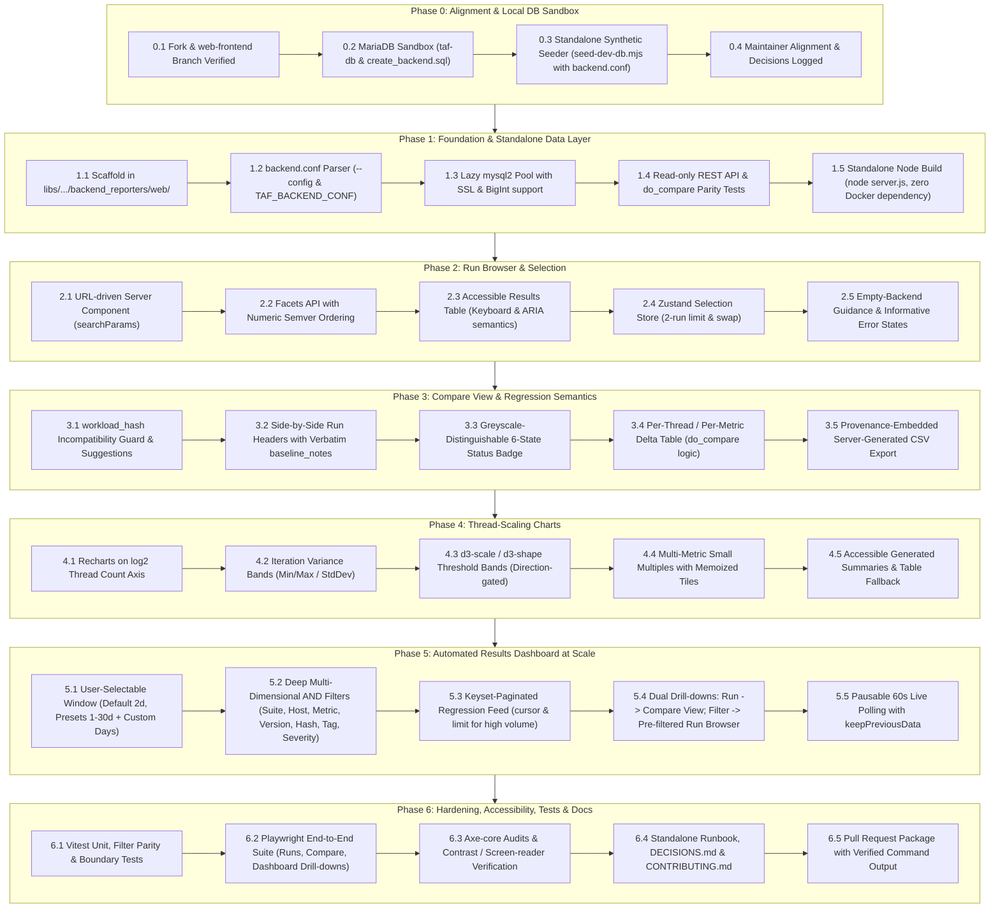

# TAF Web Frontend — Phased Implementation Plan

This implementation plan outlines the engineering roadmap to build an optional, read-only web frontend for the MariaDB Foundation's **Test Automation Framework (TAF)**, factoring in maintainer feedback regarding portability, configuration, repository layout, and enterprise-scale dashboard requirements.

---

## 1. Principles & Architectural Guardrails

Before writing any code, the following constraints must be respected across all phases:

1. **Zero Perl Modifications & Designated Location:**
   - The frontend lives at `libs/reporter_libs/backend/backend_reporters/web/`.
   - No modifications to `taf.pl`, `libs/`, `scripts/`, `test_suites/`, or `properties/`.
   - TAF continues to run independently with zero added dependencies if `web/` is absent.
2. **Standalone, Moveable & Zero Docker Dependency:**
   - The frontend is a standard Node.js application. It does **not** depend on Docker to run.
   - The entire `web/` directory is fully moveable and relocatable — it can be copied anywhere on a filesystem (local dev machine, remote server, sponsor hardware, benchmark runner host).
   - It assumes no fixed parent directory structure.
   - Docker is used only as an optional local developer convenience for spinning up a disposable test database (`taf-db`), never as a runtime requirement.
3. **Native `backend.conf` Configuration:**
   - The frontend cannot assume where `backend.conf` is located.
   - It accepts the path to TAF's standard backend configuration file via:
     - CLI argument: `--config=/path/to/backend.conf` (e.g. `node server.js --config=...` or `npm start -- --config=...`)
     - Environment variable: `TAF_BACKEND_CONF=/path/to/backend.conf`
   - A dedicated parser (`src/lib/config/backendConf.ts`) parses the key-value configuration (`backend_db_host`, `backend_db_port`, `backend_db_name`, `backend_db_user`, `backend_db_pass`, `backend_db_ssl_*`, `backend_timeout`, `backend_retries`) and feeds it into the database connection pool.
4. **Attribution & Mandatory GPLv2+ License Headers:**
   - Every newly created file (`.ts`, `.tsx`, `.sql`, `.mjs`, `.css`, `.json`, etc.) must carry the official TAF header block, including:
     - `Created:` and `Last Modified:` dates
     - Copyright: `Copyright (c) 2025-2026 MariaDB Foundation, Jonathan "jeb" Miller, and Gerardo Fontes`
     - License: GNU General Public License v2 or later (GPLv2+)
     - Explicit `PURPOSE:` and `ARCHITECTURAL ROLE:` blocks matching TAF contributor standards.
5. **Read-Only Database Access:**
   - The frontend issues read-only `SELECT` queries against `taf_backend`.
   - No `INSERT`, `UPDATE`, or `DELETE` queries, and no execution of write-side stored procedures (`insert_*`, `set_baseline*`).
6. **Strict Parity with TAF's `do_compare()` Semantics:**
   - Reproduce the 6-state classification (`PAR`, `PAR-`, `PAR+`, `WARNING`, `REGRESSED`, `GAIN`).
   - Read regression thresholds (`pct_warning`, `pct_fail`, `pct_gain`) from the **baseline** run, not the candidate.
   - Select the max-change row based on the largest **absolute raw difference** (`ORDER BY ABS(raw_diff) DESC`), matching TAF.
   - Only compare `metric_type IS NULL` or `metric_type = 'primary'` (additional metrics are excluded from comparison).
7. **Workload Compatibility Enforcement:**
   - Only runs sharing an identical `workload_hash` are validly comparable. Comparing incompatible runs must trigger an explicit warning and guard.
8. **Server-Side Aggregations & Performance at Scale:**
   - The `results` table can hold tens of thousands of rows per run, and benchmarks run continuously across multiple hosts.
   - Perform all aggregations (`AVG`, `MIN`, `MAX`) server-side in SQL.
   - Keyset pagination (cursor-based) over `(test_timestamp DESC, id DESC)` on both the run browser and the dashboard feed to eliminate `OFFSET` degradation.
9. **Scalable Dashboard & Multi-Dimensional Filtering:**
   - TAF generates thousands of results across dozens of hosts and suites.
   - Dashboard must support user-defined time windows (defaulting to **2 days**, with presets `1, 2, 3, 7, 14, 30` days plus custom numeric ranges).
   - Composable multi-dimensional `AND` filtering across 7 dimensions (suite, host, metric, db version, workload hash, tag, severity).
   - Dual drill-downs: click a run to drill into the Compare View; click a filter to open a pre-filtered Run Browser.
10. **Database Types & Timezone Integrity:**
    - Handle MariaDB `BIGINT` IDs safely (`supportBigNumbers: true`, `bigNumberStrings: true`).
    - Use `dateStrings: true` for `DATETIME` columns to avoid silent Node process timezone conversions.

---

## 2. Phased Implementation Roadmap



---

<div style="page-break-after: always;"></div>

### Phase 0: Alignment, Fork, and Local Database

*Goal: Establish a running MariaDB container, apply the schema, and create a realistic synthetic dataset.*

- [x] **0.1 Fork & Branch Verification:**
  - Verified: Active branch is `web-frontend`, origin is `gerardo-fontes/TAF.git`, upstream is `MariaDB/TAF.git`.
- [x] **0.2 Local Database Container (`taf-db`):**
  - Start the MariaDB 11 container: `docker start taf-db`.
  - Apply the backend schema:
    ```bash
    docker exec -i taf-db mariadb -uroot -ptaf < libs/reporter_libs/backend/backend_sql/create_backend.sql
    ```
  - Inspect tables and routines to confirm the 6 tables (`system_under_test`, `db_config_set`, `db_config_param`, `test_run`, `results`, `test_run_comparison`) and stored procedures (`do_compare`, `insert_*`).
- [x] **0.3 Seed Script (`libs/reporter_libs/backend/backend_reporters/web/scripts/seed-dev-db.mjs`):**
  - Implement a standalone Node script that supports `--config=/path/to/backend.conf` or `TAF_BACKEND_CONF` (with a local fallback) to populate any target MariaDB database using stored procedures.
  - Criteria:
    - 2 systems, 3 database versions, 3 test suites (`hammerdb-tpcc`, `hammerdb-tpch`, `sysbench-lua`).
    - At least 1 designated baseline (`is_baseline = TRUE`) with explicit `baseline_notes`.
    - Multiple candidate runs matching the baseline's `workload_hash`.
    - At least 1 candidate with a differing `workload_hash` (to test incompatibility guards).
    - Multi-iteration runs across thread lists (`4,8,16,32,64,128`) with primary and additional metrics.
    - Run TAF's native `CALL do_compare(baseline_id, candidate_id)` so the ground-truth `test_run_comparison` table is populated.
- [x] **0.4 Alignment Record:**
  - Create `web/DECISIONS.md` documenting maintainer decisions: placement under `libs/reporter_libs/backend/backend_reporters/web`, standalone relocatable architecture, `backend.conf` configuration, read-only posture, and reporter coexistence.

---

<div style="page-break-after: always;"></div>

### Phase 1: Foundation and Read-Only Data Layer

*Goal: Scaffold the Next.js application, implement the backend.conf configuration reader, establish the database pool, implement domain classification, and build a typed, read-only REST API with parity tests.*

- [ ] **1.1 Next.js Application Scaffolding:**
  - Manual creation in `libs/reporter_libs/backend/backend_reporters/web/` using `create-next-app` (TypeScript strict mode, App Router, Tailwind CSS, ESLint, `@/*` path aliases).
  - Manual installation of dependencies: `mysql2`, `zod`, `vitest`, `tsx`, `@testing-library/react`.
- [ ] **1.2 Configuration Reader (`src/lib/config/backendConf.ts`):**
  - Reads configuration from `--config=<path>` argument or `TAF_BACKEND_CONF` environment variable.
  - Parses TAF's key-value properties format (`enable_backend_reporting`, `backend_db_host`, `backend_db_port`, `backend_db_name`, `backend_db_user`, `backend_db_pass`, `backend_db_ssl_*`, `backend_timeout`, `backend_retries`).
  - Supports fallback to direct environment variables (`TAF_DB_*`) for cloud/container deployment if no config file is passed.
- [ ] **1.3 MariaDB Connection Pool (`src/lib/db/pool.ts`):**
  - Configure `mysql2/promise` connection pool initialized using the parsed `backend.conf` options.
  - Lazy initialization (enabling builds without a live database).
  - SSL handling using `backend_db_ssl_ca`, `backend_db_ssl_cert`, `backend_db_ssl_key`.
  - Precision settings: `dateStrings: true`, `supportBigNumbers: true`, `bigNumberStrings: true`.
- [ ] **1.4 Domain Logic & Status Classifier (`src/lib/domain/`):**
  - `status.ts`: TypeScript enum/unions for 6 comparison states (`PAR`, `PAR-`, `PAR+`, `WARNING`, `REGRESSED`, `GAIN`).
  - Implement `classifyChangePct(changePct, thresholds)` reproducing `do_compare()` step 6.
  - `threads.ts`: Robust parser for comma-separated thread strings (`"4,8,16,32,64,128"`).
- [ ] **1.5 Query Layer (`src/lib/db/queries/`):**
  - `runs.ts`: `listRuns()` with keyset pagination over `(test_timestamp DESC, id DESC)`, join to `system_under_test`, subquery counts on `results` and `test_run_comparison`.
  - `results.ts`: `listMetricNames()` and `getSeries()` with server-side `AVG()`, `MIN()`, `MAX()`, `STDDEV()` grouped by `threads`.
  - `compare.ts`: `computeComparison(baselineId, candidateId)` replicating steps 1–5 of `do_compare()` in SQL, selecting max change via `ORDER BY ABS(raw_diff) DESC LIMIT 1`.
  - `compare.ts`: `getCandidateBaselines(candidateId)` mirroring `get_candidate_baselines`.
- [ ] **1.6 API Surface & Route Handlers (`src/app/api/`):**
  - Standard response envelope (`{ data, meta }` or `{ error }`) with Zod input validation.
  - Endpoints:
    - `GET /api/health`
    - `GET /api/runs` (filters: `suite`, `host`, `dbVersion`, `workloadHash`, `tag`, `days`, `cursor`, `limit`)
    - `GET /api/runs/[id]`
    - `GET /api/runs/[id]/metrics`
    - `GET /api/runs/[id]/series`
    - `GET /api/compare?baseline=&candidate=`
    - `GET /api/dashboard?days=2&suite=&host=&metric=&dbVersion=&workloadHash=&tag=&severity=&cursor=&limit=`
- [ ] **1.7 Parity & Correctness Test Suite:**
  - Automated tests asserting that `computeComparison(baseline, candidate)` produces identical results to the stored `test_run_comparison` table created by MariaDB's stored procedure.
- [ ] **1.8 Standalone Build Ergonomics:**
  - Configure Next.js standalone output (`output: 'standalone'`) so `web/` produces a self-contained `server.js` that can be run anywhere with `node server.js --config=/path/to/backend.conf`.
  - Developer scripts: `npm run db:reset`, `npm run db:explain`. Optional `Dockerfile` for users who choose containers.

---

<div style="page-break-after: always;"></div>

### Phase 2: Run Browser (Listing, Filters, Multi-Select)

*Goal: Build the run listing table with URL-driven filters, keyboard navigation, a 2-run selection bar for comparison, and seamless drill-down reception from the dashboard.*

- [ ] **2.1 Server Component Shell (`src/app/page.tsx`):**
  - Reads `searchParams` on the server and fetches the first page of runs without a client-side loading flash.
  - Ingests incoming filter parameters forwarded from the Dashboard (`days`, `suite`, `host`, `dbVersion`, `workloadHash`, `tag`).
- [ ] **2.2 Facets Endpoint (`GET /api/facets`):**
  - Return distinct suites, database makers, versions (sorted via a custom semver comparator), systems, and tags.
- [ ] **2.3 Selection State (`src/stores/selection.ts`):**
  - Zustand store managing selected IDs (strict maximum of 2).
  - First selection serves as baseline; swap action flips roles.
  - Persisted to `sessionStorage`.
- [ ] **2.4 Accessible Data Table (`RunTable.tsx`):**
  - Semantic HTML `<table>` with `<caption>`, `<thead>`, `scope="col"`, `aria-selected` rows.
  - Display run tag, suite, database version badge, truncated CPU model tooltip, parsed thread list, right-aligned result count, baseline badge, and unshifted timestamp.
  - Keyboard navigation: Arrow keys move rows, `Space` toggles selection, `Enter` opens details.
- [ ] **2.5 Floating Compare Action Bar:**
  - Displays selected runs as chips with a swap button.
  - `Compare (2)` action routes to `/compare?baseline={id1}&candidate={id2}`.
- [ ] **2.6 Comprehensive Empty & Error States:**
  - Clear explanations when the database is empty (instructing how to enable `backend_reporting = 1`).
  - Distinct message when filters yield no matches with a "Clear Filters" button.

---

<div style="page-break-after: always;"></div>

### Phase 3: Compare View

*Goal: Compare baseline vs candidate runs with per-thread and per-metric deltas, status badges, compatibility guards, and CSV export.*

- [ ] **3.1 Compare Layout (`src/app/compare/page.tsx`):**
  - Validates `baseline` and `candidate` query params.
- [ ] **3.2 Workload Compatibility Guard:**
  - Check `workload_hash`. If hashes differ, collapse the table and display an incompatibility warning explaining that workload shapes differ, while listing compatible baselines via `getCandidateBaselines`.
  - Include an explicit "Show comparison anyway" opt-in button.
- [ ] **3.3 Run Header Pair:**
  - Side-by-side cards comparing test attributes, system details, and verbatim `baseline_notes`.
  - Swap control (flipping URL params via `router.replace`) and a return link preserving original filter state.
- [ ] **3.4 Greyscale-Accessible Status Badge:**
  - Visual status badge (`GAIN`, `PAR+`, `PAR`, `PAR-`, `WARNING`, `REGRESSED`) using distinct directional glyphs (e.g. `▲`, `▼`, `■`) and labels in addition to colors.
  - Subtext displaying exact threshold provenance (e.g. *"warning 3% / fail 5% from baseline run #12"*).
- [ ] **3.5 Comparison Delta Table:**
  - Metrics as rows; threads as columns.
  - Cells display both candidate absolute value (with unit) and percentage delta.
  - Highlights max-delta cells; displays `—` for missing data points rather than `0`.
  - Server-generated CSV export including full metadata header (run IDs, workload hashes, thresholds, generation time).
- [ ] **3.6 Client-Side Query Hydration:**
  - Hydrate server state with TanStack Query.
  - Allow user threshold overrides ("what if fail threshold were 4%?") updating query keys dynamically.

---

<div style="page-break-after: always;"></div>

### Phase 4: Thread-Scaling Charts

*Goal: Plot thread-scaling curves on a log₂ axis with iteration variance bands and D3-driven threshold regions.*

- [ ] **4.1 Core Thread-Scaling Line Chart (`ThreadScalingChart.tsx`):**
  - X-axis scaled to `log2(threads)` to reflect doubling thread experiments (`1, 2, 4, 8, 16, 32...`).
  - Solid line for baseline, dashed line for candidate (greyscale-distinguishable).
  - Shaded iteration variance area (`MIN`/`MAX` or stddev).
  - Vertical reference line marking `thread_of_max_change`.
- [ ] **4.2 Threshold Bands with `d3-scale` & `d3-shape`:**
  - Render shaded threshold zones (`WARNING`, `REGRESSED`, `GAIN`).
  - Active only when metric direction (higher-is-better vs lower-is-better) is explicitly configured.
- [ ] **4.3 Multi-Metric Small Multiples:**
  - Grid of charts for selected metrics sharing the thread x-axis but with independent y-axes.
  - Memoized chart tiles (`React.memo`) to avoid re-rendering entire grids during hover events.
- [ ] **4.4 Accessibility & Motion Preferences:**
  - Each chart includes a dynamic `aria-label` summarizing the trend and an accessible data-table fallback.
  - Honor `prefers-reduced-motion`.

---

<div style="page-break-after: always;"></div>

### Phase 5: Automated Results Dashboard at Scale

*Goal: Create an enterprise-scale automated results dashboard supporting user-defined time windows, multi-dimensional AND filtering, keyset pagination, and dual drill-downs.*

- [ ] **5.1 User-Defined Time Window (Default: 2 Days):**
  - **Default:** `days=2` (optimized for active benchmark triage and regression spotting).
  - **Preset Options:** Quick-select pills for `1`, `2`, `3`, `7`, `14`, and `30` days.
  - **Custom Range Input:** Numeric input allowing arbitrary N days (e.g. `days=45`) or explicit date boundaries.
  - Endpoint & state: `GET /api/dashboard?days=2` mapped directly to URL query parameters (`searchParams`).
- [ ] **5.2 Deep Multi-Dimensional AND Filtering:**
  - Enable engineers to isolate regressions across large result sets using composable `AND` logic:
    - **Suite:** e.g. `point-select`, `hammerdb-tpcc`, `hammerdb-tpch`, `sysbench-lua`
    - **Host / System:** filter by `host_name` or `system_id` from `system_under_test`
    - **Metric:** filter feed by primary metric (e.g. `tpmC`, `TPS`, `latency`)
    - **Database Version:** e.g. `11.8`, `11.4.3`
    - **Workload Hash:** filter comparisons sharing an exact workload shape
    - **Tags:** e.g. `MDEV-39497`, release tag
    - **Severity / Status:** `REGRESSED`, `WARNING`, `GAIN`, `PAR`, `PAR-`, `PAR+`
  - URL Representation: `/dashboard?days=2&suite=point-select&host=db94&version=11.8&severity=regressed`.
  - Dynamic parameterized query builder that constructs safe SQL filters with zero concatenation.
- [ ] **5.3 Keyset Pagination for Large Feeds:**
  - High-frequency benchmarking produces thousands of comparison rows over multi-day windows.
  - The regression feed uses cursor-based keyset pagination `(created_at DESC, id DESC)` with configurable page size (`limit=50`).
  - Response metadata includes `{ cursor, hasMore, totalMatches }`.
  - Client provides smooth "Load More" / infinite-scroll pagination without performance degradation.
- [ ] **5.4 Single-Request Aggregation Payload (`GET /api/dashboard`):**
  - Consolidates all dashboard telemetry in a single round trip to eliminate client waterfalls:
    1. **Filtered Status Roll-Up:** Counts and percentages for each comparison status across the active window and filters.
    2. **Severity-Sorted Feed:** Top regressions ordered by `FIELD(status, 'REGRESSED', 'WARNING', 'PAR-', 'PAR', 'PAR+', 'GAIN'), ABS(max_change_pct) DESC`.
    3. **Daily Timeline:** Run counts and status distribution grouped by day.
    4. **Suite Health Summary:** Total runs, regression count, and median delta per suite.
    5. **System Inventory:** Machine breakdown and prominent multi-host warning flag.
    6. **Baseline Coverage:** Percentage of runs with linked baselines.
- [ ] **5.5 Dual Drill-Down Navigation:**
  - **Run Drill-Down:** Clicking any feed item navigates directly to the Compare View:
    `/compare?baseline={baselineId}&candidate={candidateId}`
    (carries dashboard window and filter state to preserve context on back-navigation).
  - **Filter / Browser Drill-Down:** Clicking a facet badge, status tile, or "View in Run Browser" CTA navigates directly to the Run Browser with all matching filters pre-populated:
    `/runs?suite=point-select&host=db94&version=11.8&days=2`
- [ ] **5.6 Caching & Live Polling Controls:**
  - 60-second polling interval via TanStack Query (`refetchInterval: 60_000`).
  - Prominent "Live / Paused" toggle and "Last Updated" timestamp for presentation and bug reporting.
  - `placeholderData: keepPreviousData` prevents layout shifts when changing time windows or filters.

---

<div style="page-break-after: always;"></div>

### Phase 6: Hardening, Accessibility, Tests & Documentation

*Goal: Build the test matrix, run accessibility scans, document the architecture, and prepare the pull request.*

- [ ] **6.1 Unit & Integration Testing (Vitest):**
  - `backend.conf` parser tests (handling comments, quotes, types, SSL paths).
  - Multi-dimensional query builder tests verifying AND filter SQL generation and parameter binding.
  - Keyset pagination tests ensuring stable cursor progression across duplicate timestamps.
  - Classifier boundary conditions and parity with `test_run_comparison`.
  - Thread string parsing and semantic version sorting.
- [ ] **6.2 End-to-End Testing (Playwright):**
  - Automated specs for primary workflows:
    1. Run browser filtering, multi-select, and compare navigation.
    2. Compare view rendering, compatibility guards, and threshold overrides.
    3. Dashboard time window selection (`days=2`, custom days).
    4. Multi-filter AND composition (`suite=point-select` AND `severity=regressed`).
    5. Dashboard → Run Browser drill-down navigation.
    6. Dashboard → Compare view drill-down.
- [ ] **6.3 Accessibility Audit (axe-core):**
  - Automated axe-core scans in CI/tests with zero critical/serious violations.
  - Documented manual keyboard navigation pass and screen-reader audit.
- [ ] **6.4 Project Documentation:**
  - `web/README.md`: Standalone run instructions (`node server.js --config=...`), environment configuration, setup instructions, comparison semantics documentation.
  - `web/DECISIONS.md`: Record of design trade-offs and maintainer guidance.
  - `web/CONTRIBUTING.md`: Development standards, read-only constraints, and license rules.
- [ ] **6.5 Pull Request Preparation:**
  - Compile real command outputs (`npm test`, build output, EXPLAIN plans, coverage reports).
  - Prepare PR description highlighting maintainer constraints and schema observations.
